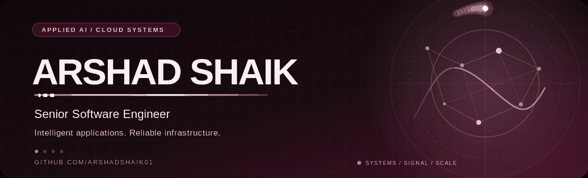
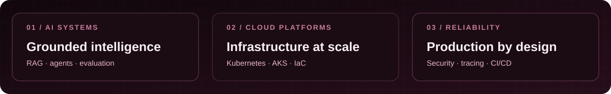
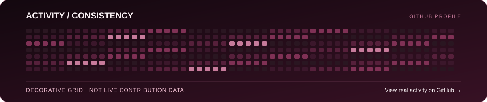

<strong>SENIOR SOFTWARE ENGINEER</strong> · Applied AI · Cloud Platforms · Distributed Systems

I build intelligent software and dependable infrastructure — making complex systems easier to operate, more secure, and more reliable.

<a href="https://github.com/ArshadShaik01?tab=repositories"><strong>Explore repositories</strong></a> &nbsp;·&nbsp; <a href="https://github.com/ArshadShaik01"><strong>View GitHub activity</strong></a>

---

### 01 / About

I'm **Arshad Shaik**, a software engineer with **5+ years of experience** across SaaS platforms, full-stack applications, cloud-native services, and applied AI. My work combines **Python, Go, TypeScript, React, Kubernetes, and LLM-driven applications**, with an emphasis on engineering quality and real-world impact.

### 02 / Selected engineering work

> These are highlights from my professional experience at **Microsoft** and **Capgemini**, not claims that employer source code is available in public repositories.

**AI-powered cloud operations assistant** · Microsoft  
Built a troubleshooting assistant with **Python, FastAPI, Azure OpenAI, and RAG**, grounding responses in technical documentation, incident histories, and runbooks. Added **LangChain, LangGraph, and MCP** workflows for secure tooling and evaluation. **Reduced incident investigation time by 40%.**

**Kubernetes security automation** · Microsoft  
Developed a **Go-based admission controller and operator** for Azure Key Vault secret rotation and Azure Policy enforcement, alongside infrastructure provisioning with **AKS, Terraform, and Bicep**.

**Safer cloud releases** · Microsoft  
Improved container delivery with readiness gates and canary deployments, **reducing deployment failures by 60%** and release lead time by **30%**. Strengthened production observability with **Prometheus, Grafana, and OpenTelemetry**.

**Multi-tenant SaaS services** · Capgemini  
Built **Go and Node.js** APIs for CRM and CMS integrations, supporting **50,000 requests per minute at peak** and **40% higher throughput**. Collaborated on **TypeScript and React** full-stack features.

### 03 / Technical toolkit

| Domain | Technologies |
| :--- | :--- |
| **Languages** | `Python` `Go` `TypeScript` `JavaScript` `SQL` `Bash` |
| **Applied AI** | `Azure OpenAI` `OpenAI API` `RAG` `LangChain` `LangGraph` `MCP` `PyTorch` `LLM Evaluation` `Vector Search` |
| **Application development** | `FastAPI` `Node.js` `React` `Ember.js` `REST APIs` `GraphQL` |
| **Cloud & orchestration** | `Azure` `AWS` `AKS` `EKS` `Kubernetes` `Docker` `Terraform` `Bicep` |
| **Data & observability** | `PostgreSQL` `MongoDB` `Snowflake` `Prometheus` `Grafana` `OpenTelemetry` |
| **Delivery & testing** | `Azure DevOps` `CI/CD` `Jest` `Supertest` `Cypress` `Unit Testing` `Integration Testing` |

### 04 / Experience

**Microsoft** — Senior Software Engineer  
*Aug 2024 – Present · Tempe, Arizona*

- Built and evaluated agentic cloud troubleshooting workflows; automated Kubernetes security and Azure infrastructure operations.
- Improved observability and incident response, reducing **incident detection time by 40%** and **P1 resolution time by 35%**.

**Capgemini** — Software Engineer  
*Oct 2020 – Jul 2023 · Bengaluru, India*

- Delivered full-stack SaaS features and high-throughput microservices.
- Increased automated test coverage from **42% to 78%** and reduced tenant provisioning time by **70%** using Kubernetes controllers and operators.

### 05 / Education & credentials

**Arizona State University** — Master's in Information Technology

- Microsoft: Azure AI Cloud Developer Associate
- Microsoft: Azure Administrator Associate (AZ-104)

*Certification titles are reproduced as listed on my resume; verification links can be added when available.*

### 06 / GitHub activity

**[See my actual contributions on GitHub](https://github.com/ArshadShaik01)** — the official profile shows the real contribution calendar. The design above is decorative, not a record of commits or contribution counts.

---

<strong>Interested in applied AI, reliable developer platforms, and pragmatic engineering?</strong>

<a href="https://github.com/ArshadShaik01">GitHub profile</a> · <a href="https://github.com/ArshadShaik01?tab=repositories">Public repositories</a>

