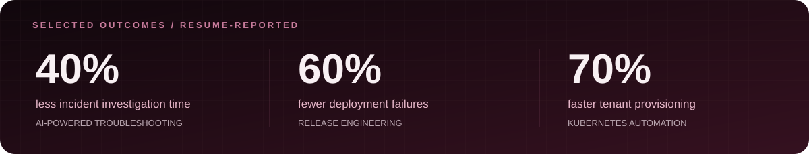
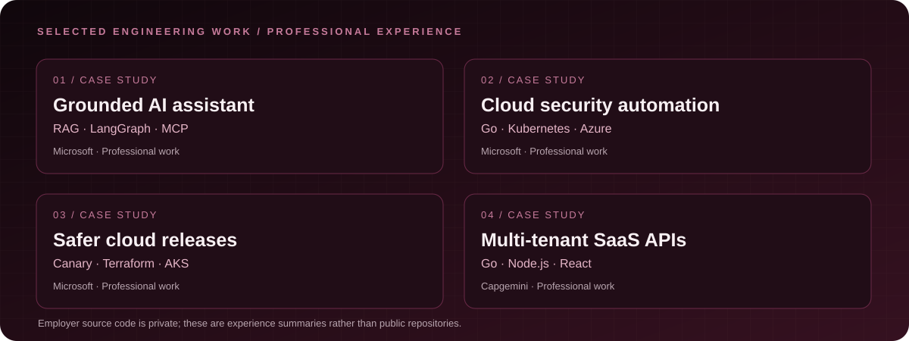
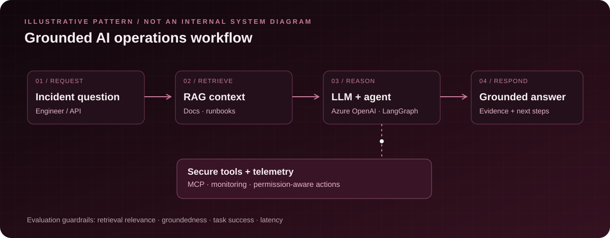
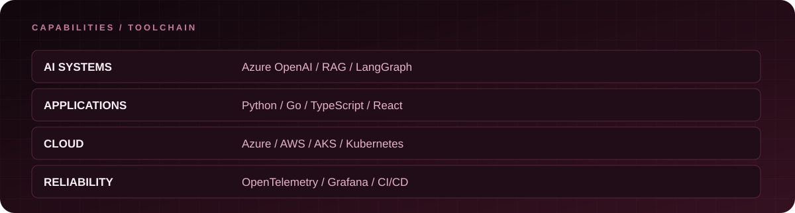
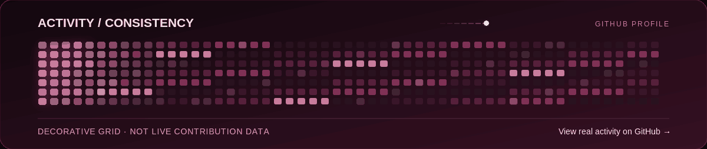

**SENIOR SOFTWARE ENGINEER** · Applied AI · Cloud Platforms · Distributed Systems

Building grounded AI applications and dependable infrastructure, with engineering rigor from prototype to production.

[Explore public repositories](https://github.com/ArshadShaik01?tab=repositories) · [View real GitHub activity](https://github.com/ArshadShaik01)

---

### 01 / Engineering, with intent

I'm **Arshad Shaik** — a Senior Software Engineer with **5+ years** building SaaS platforms, full-stack systems, cloud-native infrastructure, and applied AI solutions. I work across **Python, Go, TypeScript, React, Kubernetes, RAG, and AI agents**, prioritizing production reliability, security, and measurable outcomes.

### 02 / Selected engineering work

> **Professional experience, not public source code.** These are engineering highlights from Microsoft and Capgemini; they are not links to proprietary employer repositories.

**01 · Grounded cloud-operations assistant — Microsoft**  
Developed an AI-assisted troubleshooting workflow using **Python, FastAPI, Azure OpenAI, and RAG** over technical documentation, incident histories, and runbooks. Built agent workflows with **LangChain, LangGraph, and MCP**, including evaluation of retrieval and response quality. **Reported impact:** ~40% shorter incident investigations.

**02 · Kubernetes security automation — Microsoft**  
Developed a **Go-based admission controller and operator** using Azure Key Vault and Azure Policy for secret lifecycle and policy enforcement. Supported cloud provisioning using **AKS, Terraform, and Bicep**.

**03 · Reliable release engineering — Microsoft**  
Improved canary delivery, readiness gates, and observability using **Prometheus, Grafana, and OpenTelemetry**. Reported outcomes include **60% fewer deployment failures** and **30% shorter release lead time**.

**04 · Multi-tenant SaaS services — Capgemini**  
Built APIs with **Go and Node.js**, supporting CRM/CMS integrations and full-stack features using **TypeScript and React**. Reported peak handling of **50,000 requests/minute**.

### 03 / How I approach AI systems

*This is a conceptual reference architecture based on technologies I work with, **not** an internal Microsoft system diagram.*

My design priorities are grounded answers, authorization-aware tool execution, observable workflows, and evaluations for retrieval quality, agent task success, and inference latency.

### 04 / Technology landscape

| Area | Technologies |
| :--- | :--- |
| **Languages** | `Python` `Go` `TypeScript` `JavaScript` `SQL` `Bash` |
| **AI engineering** | `Azure OpenAI` `RAG` `LangChain` `LangGraph` `MCP` `PyTorch` `LLM Evaluation` `Vector Search` |
| **Applications** | `FastAPI` `Node.js` `React` `REST` `GraphQL` |
| **Cloud & infrastructure** | `Azure` `AWS` `AKS` `EKS` `Kubernetes` `Docker` `Terraform` `Bicep` |
| **Data & observability** | `PostgreSQL` `MongoDB` `Snowflake` `OpenTelemetry` `Prometheus` `Grafana` |
| **Delivery & testing** | `CI/CD` `Azure DevOps` `Jest` `Supertest` `Cypress` |

### 05 / Future open-source build concepts

These are **ideas for public portfolio projects**, not completed projects or published repositories:

- **RAG Reliability Lab** — An evaluation harness comparing retrieval quality, groundedness, and latency across retrieval strategies.
- **Agent Tool Security Playground** — A sandbox to explore MCP tool permissions, safe execution, and audit trails.
- **Cloud Incident Simulator** — A reproducible incident environment for testing agent-assisted diagnosis and operational runbooks.

If I release any of these projects, I will link to the actual source repositories here.

### 06 / Experience & education

**Microsoft** — Senior Software Engineer · *Aug 2024–Present*  
**Capgemini** — Software Engineer · *Oct 2020–Jul 2023*  
**Arizona State University** — Master's in Information Technology

**Credentials listed on my resume:** Microsoft Azure AI Cloud Developer Associate; Microsoft Azure Administrator Associate (AZ-104). Verification links can be added when available.

### 07 / GitHub activity

*The animation above is decorative and does not represent actual commit counts or contribution history.* [See my real GitHub contributions](https://github.com/ArshadShaik01).

---

**Thoughtful systems. Measurable outcomes. Reliable delivery.**

[GitHub profile](https://github.com/ArshadShaik01) · [Public repositories](https://github.com/ArshadShaik01?tab=repositories)

